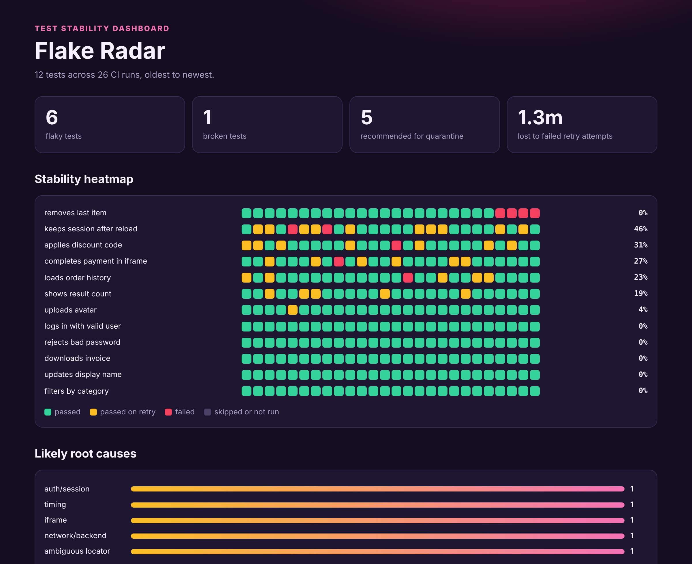
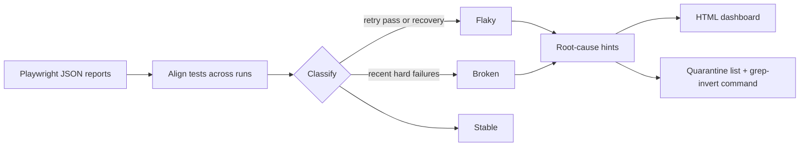

<div align="center">

# 📡 Flake Radar

### Stop re-running CI and hoping. See which Playwright tests are lying to you, and why.

[](https://github.com/s78519300-creator/flake-radar/actions/workflows/ci.yml)




</div>

One Playwright report tells you what happened in one run. Flakiness only shows up across many. Flake Radar reads your JSON reports from CI history and answers four questions:

1. **Which tests are unstable?**
2. **Are they flaky or actually broken?** These need different responses, and quarantining a broken test hides a real bug.
3. **What's the likely root cause, and what should I try first?**
4. **What can be safely quarantined today?** You get a ready-to-run command.

## Quickstart

No dependencies. Python 3.10+ reads the reports, and your tests can be in any language Playwright supports.

```bash
git clone https://github.com/s78519300-creator/flake-radar
cd flake-radar
pip install -e ".[dev]"

flake-radar examples/reports --html radar.html --quarantine quarantine.json
```

```text
12 tests, 26 runs, 7 unstable, 5 to quarantine
broken    0%  assertion          cart.spec.ts › removes last item [chromium]
flaky    46%  auth/session       login.spec.ts › keeps session after reload [chromium]
flaky    31%  timing             checkout.spec.ts › applies discount code [chromium]
flaky    27%  iframe             checkout.spec.ts › completes payment in iframe [chromium]
flaky    23%  network/backend    orders.spec.ts › loads order history [chromium]
flaky    19%  ambiguous locator  search.spec.ts › shows result count [chromium]
flaky     4%  stale element      profile.spec.ts › uploads avatar [chromium]
```

The sample reports are synthetic and seeded, generated by `examples/generate_reports.py`.

## Use it on your project

```ts
// playwright.config.ts
export default defineConfig({
  retries: process.env.CI ? 2 : 0,
  reporter: [['json', { outputFile: `reports/run-${process.env.GITHUB_RUN_ID}.json` }]],
});
```

Keep the reports from recent runs in one folder, then:

```bash
flake-radar reports --html radar.html --quarantine quarantine.json --fail-on-flaky
```

## How tests are classified

| Class | Rule | Action |
|---|---|---|
| 🟢 stable | No instability | None |
| 🟡 flaky | Passed on retry, failed then recovered, or passed and failed on the same commit | Stabilise, and quarantine if it's frequent |
| 🔴 broken | Last 3 executions failed outright | Fix now, **never quarantine** |

A flaky test is recommended for quarantine when its instability is at least 15% over at least 5 runs. Both are configurable with `--threshold` and `--min-runs`.

## Root-cause hints

| Signal in the error | Class | First thing to try |
|---|---|---|
| `401`, `403`, session expired | auth/session | Reuse a saved `storageState` from a setup project |
| `frame was detached` | iframe | Use `frameLocator` and wait inside the frame |
| `not attached to the DOM` | stale element | Use locators rather than stored handles |
| `strict mode violation` | ambiguous locator | Tighten with `getByRole` or `getByTestId` |
| `net::ERR_`, `502`–`504` | network/backend | Mock unstable dependencies or check health first |
| `page.goto`, `waitForURL` | navigation | Wait for a URL or landmark instead of load events |
| `Timeout`, `toBeVisible` | timing | Use web-first assertions on the state that matters |

Hints come from pattern-matching error messages, so treat them as a starting point for debugging, not a diagnosis.

## How it works



## Development

```bash
pytest
python examples/generate_reports.py   # regenerate the sample reports
```

## License

MIT
